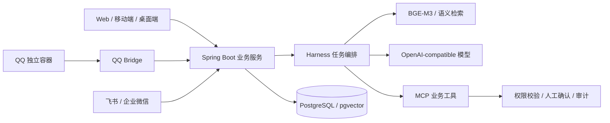

# 证链智协 · 可信 AI 客户协作系统

证链智协将客户档案、沟通时间线、语义检索、AI 分析与团队执行连接在同一业务流程中。系统以客户事实为上下文，通过 Harness 编排模型和工具，把分析结果转化为可确认、可跟进、可追溯的业务动作。

## 核心功能

- **客户协作**：客户档案、沟通记录、客户公共池、跟进提醒、任务、日报与成单管理。
- **AI 客户洞察**：BGE-M3 向量检索、历史沟通召回、结构化分析、引用来源回溯及分析版本管理。
- **智能助手与 MCP**：面向客户业务的工具调用、身份与 Scope 校验、操作确认和审计记录。
- **QQ 实例容器化**：成员独立实例、会话预览、客户归属、确认入库与原文加密留存。
- **飞书与企业微信**：工作台入口、业务机器人、客户信息同步与对话式业务协作。
- **经营大屏**：客户分层、业务阶段、团队执行与经营指标的集中展示。
- **多端访问**：Web、Android、iOS、Tauri 桌面端和原生 macOS 客户端。

## 架构与技术栈



| 模块 | 技术 |
| --- | --- |
| 业务后端 | Java 21、Spring Boot、Spring Security、JPA、Flyway |
| Web 工作台 | Vue 3、TypeScript、Pinia、Vite |
| 数据与检索 | PostgreSQL 18、pgvector、BGE-M3、Ollama |
| 模型及工具 | OpenAI-compatible API、MCP、业务工具注册与执行上下文 |
| QQ 桥接 | Node.js、TypeScript、Dockerode、WebSocket、QCE/NapCat |
| 移动端 | Kotlin / Jetpack Compose、Swift / SwiftUI |
| 桌面端 | React / Tauri / Rust、原生 Swift 客户端 |
| 部署 | Docker Compose、Nginx |

## 源码目录

```text
cloud-java/
  backend/          Spring Boot 业务后端、数据库迁移和测试
  frontend/         Web 工作台
  forum-frontend/   社区前端
  qq-bridge/        QQ 容器与会话桥接
  android-app/      Android 客户端
  ios-app/          iOS 客户端
  contracts/        接口契约
  deploy/           Nginx、数据库镜像、QQ 构建补丁及脚本
  scripts/          契约检查脚本
  docker-compose.yml
src/                React 桌面界面
src-tauri/          Tauri / Rust 桌面服务
native-mac/         原生 macOS 客户端
```

## 快速部署

准备 Docker Engine、Docker Compose v2。首次启动会构建应用镜像、初始化数据库，并下载配置的向量模型。

```bash
git clone https://github.com/cmijohnson/zhenglian-zhixie-source.git
cd zhenglian-zhixie-source
```

进入项目后：

```bash
cd cloud-java
cp .env.example .env
```

在 `.env` 中设置以下值：

| 变量 | 用途 |
| --- | --- |
| `POSTGRES_PASSWORD` | 数据库密码 |
| `BOOTSTRAP_ADMIN_USERNAME` | 首次初始化管理员账号 |
| `BOOTSTRAP_ADMIN_PASSWORD` | 首次初始化管理员密码 |
| `AI_BASE_URL` / `AI_MODEL` / `AI_API_KEY` | 兼容模型接口、模型 ID 和密钥 |
| `AI_SETTINGS_MASTER_KEY` | 模型配置加密密钥 |
| `YINGGE_WEBHOOK_MASTER_KEY` | Webhook 配置加密密钥 |
| `HTTP_PORT` | Web 访问端口，默认 8080 |

加密主密钥使用 32 字节随机值的 Base64 编码，可分别执行 `openssl rand -base64 32` 生成。每项主密钥独立生成，并保存到部署环境。`.env` 已纳入 Git 忽略规则。

```bash
docker compose config --quiet
docker compose up -d --build
docker compose ps
```

浏览器访问 `http://localhost:8080`，使用初始化账号登录。配置外部 HTTPS 网关时同步设置 `SESSION_COOKIE_SECURE=true`、MCP issuer/resource/origin 及第三方平台回调地址。

### QQ 容器桥接

配置 `QQ_BRIDGE_SHARED_TOKEN` 和 `QQ_DATA_MASTER_KEY`，然后构建固定版本的 QCE 集成镜像并启用桥接：

```bash
sh deploy/scripts/build-qce-image.sh
docker compose -f docker-compose.yml -f deploy/docker-compose.qq.yml config --quiet
docker compose -f docker-compose.yml -f deploy/docker-compose.qq.yml up -d --build
```

QCE 构建脚本使用固定源码 revision，并应用仓库内的集成补丁。镜像构建需要访问对应上游仓库；运行桥接需要 Docker socket，以创建成员实例。

### 飞书与企业微信

飞书入口通过 `FEISHU_WORKBENCH_BASE_URL`、`FEISHU_OAUTH_REDIRECT_URI` 和 `FEISHU_INTEGRATION_MASTER_KEY` 配置，应用身份与业务绑定在管理端维护。企业微信通过 `WECOM_AIBOT_*`、`WECOM_AGENT_*` 配置机器人连接与模型服务。各平台回调地址与部署域名保持一致。

## 本地开发与测试

后端使用 JDK 21 和 Maven；Web 与 QQ Bridge 使用 Node.js 22 和 npm。

```bash
# 在仓库根目录执行
(cd cloud-java/backend && mvn verify)
(cd cloud-java/frontend && npm ci && npm run build && npm run test:unit)
(cd cloud-java/qq-bridge && npm ci && npm run build && npm test)
```

后端集成测试使用数据库与 Testcontainers，执行完整测试时启动 Docker。Android 使用 Android Studio 打开 `cloud-java/android-app`；iOS 使用 Xcode 打开对应工程；原生 macOS 客户端使用 `native-mac/Package.swift`。

本次源码整理验证：后端 Maven 打包、Web 构建通过；Web 单元测试 129 项、QQ Bridge 测试 15 项通过。运行环境所需的账号、模型接口和外部平台应用由部署者配置。

## 开发记录

以下时间对应原仓库真实提交的作者日期，时区为 UTC+08:00。历史源码经过与当前版本相同的脱敏处理后重新导入，因此提交哈希发生变化；原始哈希写入各提交消息的 `Original-Commit` 字段。提交者日期记录本次导入时间，作者身份统一匿名化。

| 原始日期 | 开发进度 |
| --- | --- |
| 2026-07-29 19:53 | 项目首次纳入 Git，形成基础工程 |
| 2026-08-04 17:14 | 增加绩效中心，更新经营大屏 |
| 2026-08-14 02:55 | 增加客户协作业务流程 |
| 2026-08-14 05:26 | 增加经营洞察与客户 RAG |
| 2026-08-14 14:19 | 加强 QQ 原始沟通数据存储安全 |
| 2026-10-28 10:38 | 主仓库许可证更新为 GPL-3.0 |
| 2026-10-30 | 汇入现存工作区功能、整理脱敏源码、补齐构建入口与 README |

原仓库提交之后的工作区增量按本次整理日期记录。远端仅维护 `main`；已上传的源码快照提交保留，开发历史通过一次合并接入，后续维护直接在 `main` 增量提交。

```bash
git log --all --date=iso-strict --format='%h %aI %s'
```

## 许可证

主项目遵循 [GPL-3.0](LICENSE)。第三方组件的许可和对应源码要求见 [第三方声明](cloud-java/THIRD_PARTY_NOTICES.md)。QCE 集成补丁与构建脚本随本仓库提供，模型通过独立服务接入。
